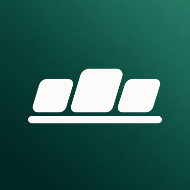

  

<h1 align="center">TV Shelf · Полка</h1>

<strong>Put your favorite TV apps one button away.</strong>

A free, open-source launcher for Google TV and Android TV.

  
  
  
  

  <a href="https://github.com/alpershin/tv-shelf/releases/latest">Download APK</a> ·
  <a href="#quick-start">Quick start</a> ·
  <a href="BUILD.md">Build from source</a>

> Tested on Xiaomi TV Stick 4K (2nd Gen), Google TV with Android 14. Device checks covered directional navigation, tile ordering, and returning Home from another app and system settings.

## Why TV Shelf?

- **Favorites at a glance.** Pin apps to a horizontal shelf. The focused tile grows and colors the background.
- **Quick actions.** Set up shortcuts to Wi-Fi, a VPN client, a browser, or another installed app. Wi-Fi and VPN indicators follow their connection states.
- **Apps by icon.** Browse installed TV apps or reopen apps recently launched from the shelf.
- **Made for the remote.** Use the directional pad and center button. The interface follows the system’s light or dark theme.

## Quick start

1. Download **tv-shelf.apk** from [Releases](https://github.com/alpershin/tv-shelf/releases/latest).
2. Sideload it. If the TV is already connected through ADB, run `adb install -r tv-shelf.apk`.
3. Open **Полка** from the TV’s app list. Use **Настроить полку** to pick favorites and shortcuts.
4. To reorder a tile, hold the center button, then move it left or right. Press the center button again to save or Back to cancel.

### Open TV Shelf with Home

Open **Настроить полку → Домашний экран → Выбор домашнего экрана Android** and select **Полка**. On Google TV builds that keep opening the stock home screen, enable **Полка по кнопке Home** in Accessibility settings. The optional service reacts to the stock home window appearing without permission to retrieve window content.

To restore the stock experience, turn off **Полка по кнопке Home** and select the system launcher in Android’s Home settings. If the stock packages were disabled separately via ADB, re-enable them before removing TV Shelf.

## Known limitations

- Minimum supported API level is 26. Hardware checks have focused on the Xiaomi TV Stick 4K (2nd Gen).
- Home routing varies by firmware. With the optional Accessibility service enabled, Google TV Home can briefly appear before TV Shelf.
- The recent list covers apps launched from the shelf.
- The app interface is currently in Russian.

## Contributing

See [BUILD.md](BUILD.md) for build and device checks. Include the TV model and Android version when reporting Home or remote navigation behavior.

## License

[MIT](LICENSE)
